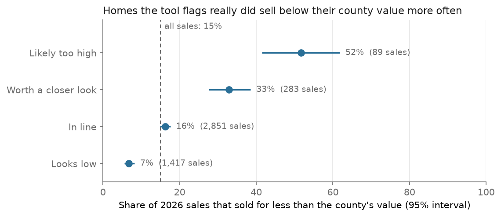
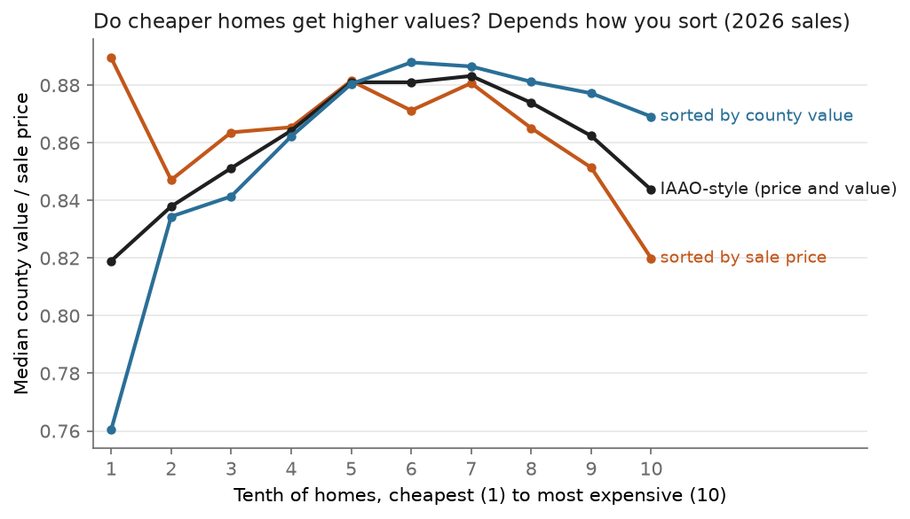

# Square Deal

**Is your 2026 Franklin County home value a square deal?** A free website that checks the county's new value for each of Franklin County's 297,291 single-family homes against what similar homes nearby sold for. It shows the comparable sales and how to challenge the value by the March 31, 2027 deadline. Alongside it is a fairness study of the county's 2026 values.

**Live: [ajthakkar.github.io/square-deal](https://ajthakkar.github.io/square-deal/)** · Data refreshes monthly from the county's public files · [Why I built this](docs/decision.md)



## What it found

| | |
|---|---|
| Homes checked | 297,291 of 303,082 single-family homes (the rest have more than one building or incomplete records) |
| Accuracy on 9,173 sales from 2026, after the valuation date, that it never saw | Typical miss **8.2%**, vs. **8.9%** for the county's own values (COD 9.3 vs. 10.2) |
| "Your value may be too high" | 7,887 homes. In testing, **52%** of homes flagged this way sold for less than their county value (95% interval 41–62%), vs. **15%** of all homes |
| "Worth a closer look" | 18,861 homes; 33% sold below their county value |
| "Looks low" | 92,093 homes; 7% sold below their county value. Filing could raise these. |
| Are the county's values fair overall? | Yes, by the IAAO's standards, on 2026 sales: uniformity (COD) 10.2, PRD 1.01, PRB +0.006. No sign that cheaper homes are over-valued once non-market sales are screened out. |

## Why

Franklin County updated every property value for 2026; the median single-family home went up 10.7%. An owner who thinks their value is too high can file a free complaint (DTE Form 1) with the county Board of Revision, but has to prove the home's market value, and the county lists comparable sales as evidence. The county's site doesn't compare a home with similar sales, and the paid services that do charge for it. Square Deal does it for every single-family home, for free, and shows its work. How I picked this project out of eight options, with the checks I ran first, is in [docs/decision.md](docs/decision.md).

## How it works

All of it is built from the Franklin County Auditor's public monthly extracts: home characteristics, values, every recorded sale with the county's own validity call, and parcel maps.

1. **Comparable sales.** 31,353 single-family sales from 2023–2025 that the county marked as valid market sales.
2. **Time.** A monthly price index (median of sale price ÷ 2026 value) restates each sale to January 1, 2026, the date values are set for. Prices rose about 13% over the three years.
3. **What features are worth.** A log-linear regression of price on size, effective age, quality grade, condition, baths, beds, basement, lot, air conditioning, and style, with effects for the county's 1,000+ appraisal neighborhoods. Neighborhoods with few sales borrow from their ZIP code.
4. **The five most similar sales.** Among the 40 nearest within two miles, ranked on distance, size, age, quality, neighborhood, and recency. Each is adjusted for how it differs from the home.
5. **The estimate.** A blend of the adjusted comps and the regression. The weight was chosen on 2025 sales, each estimated without its own sale.
6. **The verdict.** A logistic regression on 2026 sales estimates the chance that a home like this sold for less than its county value. It uses the gap between the county's value and the estimate, how much the comps disagree, and the price level. "May be too high" means the county's value is above the estimate and at least 4 in 10 similar homes sold for less; "worth a closer look," at least 1 in 4; "looks low," fewer than 1 in 10.
7. **Testing.** The likely range and the verdict model were fitted on a random half of the 2026 sales and checked on the other half. The 80% range held 79.6% of sale prices, and predicted chances matched what happened.

Code: `src/squaredeal/` (load, features, screen, timeindex, hedonic, comps, verdict, ratio), with scripts in `scripts/` and tests in `tests/`. The site is Next.js in `site/`, a static export with every result precomputed, so an address typed into it never leaves the browser.

## Three things that almost fooled me

- **Testing the county on its own homework.** On 2025 sales, the ones the county used to set its values, its values look nearly perfect (COD 6.2). The fair test is sales from after the valuation date. I also checked for "sales chasing", setting sold homes' values to their prices: within a neighborhood, sold and unsold homes' values changed by nearly the same amount (0.3 points apart).
- **Sales that weren't really sales.** 2026 sales aren't validated yet. In 2025, only 71% of single-parcel deed sales turned out to be valid market sales, and only 35% for homes under $150,000. The rest mostly sold below the county's value. My first test counted them and made the county look worse (22% of homes "selling below value," and cheap homes looking over-valued). So `screen.py` learns the county's validity calls from 2023–2025, using only facts known at the time of sale and never the price: company buyer or seller, quick resale, deed type, the home. It raised the valid share from 71% to 82% on 2025 sales it didn't train on (AUC 0.79). With it, 15% of homes sold below their value, and the cheap-home pattern disappeared.
- **Flagging the wrong homes.** My first verdict flagged a home when its county value was above the top of its likely range. That over-flagged expensive homes, whose estimates are less certain than their comps suggest. The calibrated chance model replaced it. Sorting homes by price to look for regressivity is its own trap: sorted by sale price, cheap homes look over-valued; sorted by county value, the reverse. The IAAO's method, which sorts on a mix of the two, shows neither.



## Limits

- It knows only what the county's records say. Renovations or damage the county doesn't know about aren't in the estimate.
- The test sales are screened, not validated; about 18% of what the screen keeps would likely still be judged invalid. Precision figures will be rechecked once the county validates 2026 sales.
- It's not an appraisal. The Board of Revision weighs evidence its own way, and a recent sale of the home itself or an appraisal is stronger evidence than comps.
- Single-family homes only: no condos, duplexes, or multi-building parcels.
- The yearly tax difference is approximate: 2025 effective rates per tax district, scaled for the 2026 update, for an owner-occupant.

## Run it

```bash
python -m venv .venv && .venv/Scripts/activate      # macOS/Linux: source .venv/bin/activate
pip install -e ".[dev]"
pytest                                    # 8 tests
python scripts/fetch.py                   # ~350 MB of county files into data/raw
python -c "from squaredeal import pipeline; pipeline.prepare(refresh=True)"
python scripts/validate.py                # results/validation.json
python scripts/report.py                  # results/report.json, charts
python scripts/export_site.py             # site/public/data
cd site && npm ci && npm test && npm run build    # static site in site/out
```

`.github/workflows/refresh.yml` does all of this monthly and deploys to GitHub Pages. To count visits without cookies, set a repository variable `GOATCOUNTER` to a GoatCounter site code; to link a feedback form, set `FEEDBACK_URL`.

## Data and disclaimer

Data: Franklin County Auditor public downloads (apps.franklincountyauditor.com). Values, home details, and sales are public records. Owner names are used only to tell people from companies when screening sales; they are never stored in the outputs or shown. Square Deal isn't affiliated with the Franklin County Auditor and isn't legal or tax advice. Code is MIT-licensed.
